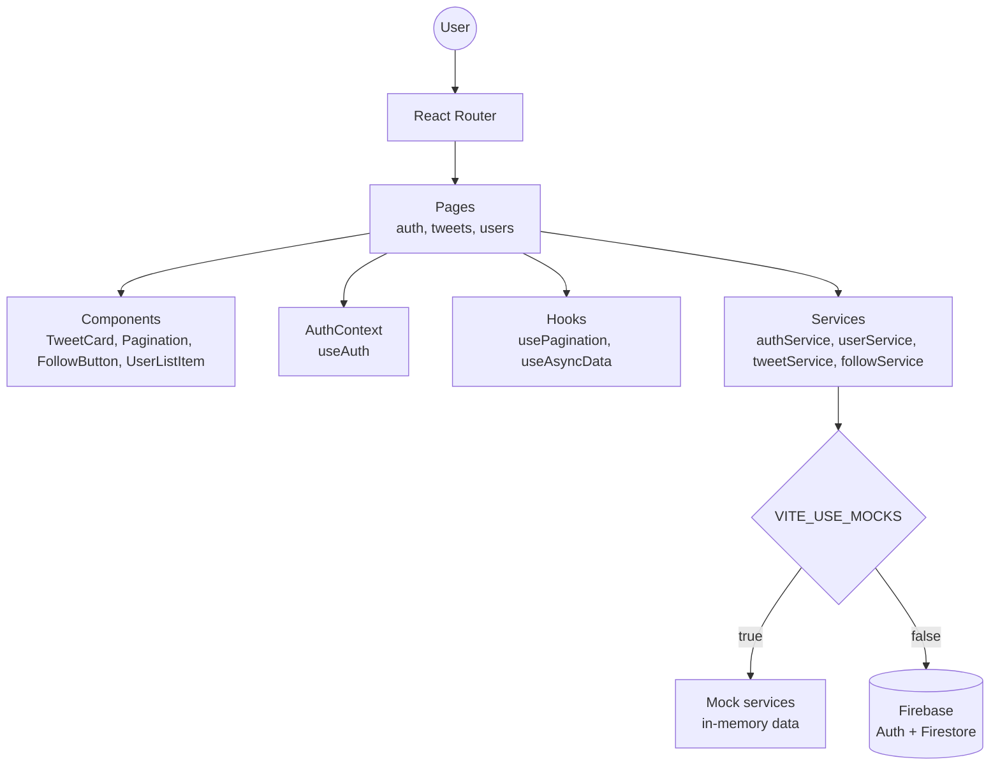
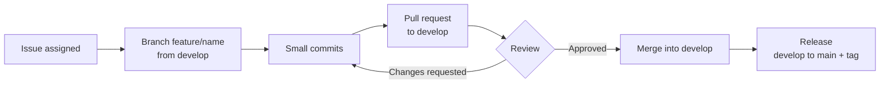

# X Clone – Team SixSeven

A clone of the social network X (formerly Twitter), built as a Single Page Application with React.js and Firebase for the **Software Development Elective I** course.

Users can register, log in (with username and password or with Google), publish tweets, follow other users and see the tweets of the people they follow.

## Team

| Name | GitHub | Main responsibilities |
|---|---|---|
| Andrés Bolívar | [@AN1D31](https://github.com/AN1D31) | Team lead, architecture, routing, auth context, shared components, code review, releases |
| Susana Sánchez | [@Susa31](https://github.com/Susa31) | Firebase, mock data, services layer, register and login pages, Google sign-in |
| Valentina Mejía | [@ValenMejiaC](https://github.com/ValenMejiaC) | Followers and following lists, user tweets page, follow button |
| Yésica | [@Yesicaazul](https://github.com/Yesicaazul) | Home, compose tweet and feed pages |

## Tech stack

- **React 19** with **Vite**: user interface
- **React Router 7**: client-side routing
- **Firebase** (Authentication + Firestore): authentication and data storage
- **ESLint**: code quality
- **Git + GitHub**: version control, pull requests and code review

## Getting started

### Prerequisites

- Node.js (LTS version)
- npm

### Installation

```bash
git clone https://github.com/AN1D31/CS1_TwitterClone_EquipoSixSeven.git
cd CS1_TwitterClone_EquipoSixSeven
npm install
```

### Environment variables

Copy `.env.example` to a new file called `.env`:

```bash
cp .env.example .env
```

| Variable | Description |
|---|---|
| `VITE_USE_MOCKS` | `true` (default): the app uses mock data and works without Firebase. `false`: the app uses Firebase |
| `VITE_FIREBASE_*` | Firebase web app configuration. Required for Google sign-in and for `VITE_USE_MOCKS=false` |

The `.env` file is never committed.

### Run the app

```bash
npm run dev
```

The app runs at `http://localhost:5173`.

> After every `git pull`, run `npm install` again if `package.json` changed.

### Demo account (mock mode)

| Username | Password |
|---|---|
| `anatorres` | `Clave1234` |

Every mock user shares the same password. Users registered while the app runs are kept in memory and disappear on reload.

### Available scripts

| Script | Description |
|---|---|
| `npm run dev` | Starts the development server |
| `npm run build` | Builds the app for production |
| `npm run preview` | Previews the production build |
| `npm run lint` | Runs ESLint |

## Routes

| URL | Page |
|---|---|
| `/auth/login` | Login with username and password, or with Google |
| `/auth/register` | Register with full name, username, email and password |
| `/` | Home: tweet link and followers / following counters |
| `/tweets/feed` | Recent tweets from the user and the people they follow |
| `/tweets/compose` | Publish a new tweet (maximum 280 characters) |
| `/users/:username` | Tweets of a user, with counters and follow button |
| `/users/:username/followers` | Followers of a user |
| `/users/:username/following` | Users followed by a user |

Unknown URLs show a "Not found" page.

## Milestones

### Milestone 1 – SPA layout (due October 31, 2026)

- [x] Register page
- [x] Login page (username/password and Google sign-in)
- [ ] Home page with tweet link and counters
- [ ] Compose tweet page
- [x] Following list (alphabetical, 10 per page)
- [x] Followers list with follow button (alphabetical, 10 per page)
- [x] User tweets page (newest first, 10 per page)
- [ ] Feed page (10 per page)
- [ ] Shared header (logo, username, logout)

### Milestone 2 – User features and tweets (due November 21, 2026)

Registration, login and tweet publishing with Firebase.

### Milestone 3 – Follow features and lists (due November 28, 2026)

Follow logic, followers and following lists with real data.

## Architecture

The project follows **Screaming Architecture**: the code is organized by feature, so the folder structure shows what the app does. Each feature owns its pages, components, routes, services and data.

### Project structure

```
src/
  main.jsx                 Entry point (BrowserRouter)
  XCloneApp.jsx            Root component (AuthProvider + AppRouter)
  routes/                  AppRouter: connects all feature routes
  auth/                    Authentication
    components/            Form fields
    context/               AuthContext and AuthProvider
    hooks/                 useAuth
    pages/                 LoginPage, RegisterPage
    reducers/              authReducer
    routes/                AuthRoutes
    services/              authService (mock and Firebase)
    types/                 Action types
  tweets/                  Tweets
    components/            TweetCard
    data/                  Mock tweets
    pages/                 FeedPage, ComposeTweetPage
    routes/                TweetsRoutes
    services/              tweetService (mock and Firebase)
    utils/                 formatTweetDate
  users/                   Users and follows
    components/            UserListItem, FollowButton, FollowCounts...
    data/                  Mock users and follows
    hooks/                 useAsyncData
    pages/                 UserTweetsPage, FollowersPage, FollowingPage
    routes/                UsersRoutes
    services/              userService, followService (mock and Firebase)
  pages/                   HomePage, NotFoundPage
  ui/                      Shared UI
    components/            Pagination
    hooks/                 usePagination
    layouts/               MainLayout
  firebase/                Firebase config and data source mode
```

### Application layers



Pages and components never access data directly. They always call a service, and each service chooses its data source (mock or Firebase) in a single place. Moving from mock data to Firebase only changes the data source, not the UI.

### Development workflow



## Data model

```
user:   { id, fullName, username, email, avatarUrl, createdAt }
tweet:  { id, authorId, body, createdAt }
follow: { followerId, followingId, createdAt }
```

`followerId` follows `followingId`. Dates use ISO 8601 format.

Every tweet is shown in this format:

```
Full name, @username - Publication date and time
Tweet body
```

## Git workflow

### Branches

| Branch | Purpose |
|---|---|
| `main` | Stable releases only (one per milestone) |
| `develop` | Integration branch (default) |
| `feature/<name>` | New features, e.g. `feature/login-page` |
| `fix/<name>` | Bug fixes |
| `docs/<name>` | Documentation |

Both `main` and `develop` are protected: every change goes through a pull request with at least one approval from another team member.

### Commit messages

We follow [Conventional Commits](https://www.conventionalcommits.org/):

| Prefix | Use |
|---|---|
| `feat:` | New feature |
| `fix:` | Bug fix |
| `docs:` | Documentation |
| `style:` | Formatting, no logic changes |
| `refactor:` | Code changes without new features or fixes |
| `chore:` | Configuration, dependencies |

Example: `feat: add pagination to followers list`

### Workflow

1. Pick an issue assigned to you.
2. Update `develop`, run `npm install` and create a branch: `git checkout -b feature/<name>`.
3. Commit small, clear changes, adding only the files of your issue.
4. Before opening the pull request, merge the latest `develop` into your branch and run `npm run lint`.
5. Open a pull request to `develop`, fill the template and write `Closes #<issue>`.
6. Request a review from a teammate. Approvals are given with **Review changes → Approve**.
7. Merge once approved and delete the branch.

## Code rules

- All code, comments and documentation in English (user-facing text in Spanish).
- camelCase for variables and functions, PascalCase for components.
- Only `let` and `const`.
- Code indented with tabs.
- Maximum two nesting levels per function; extract a new function otherwise.
- Self-explanatory names (e.g. `sortUsersByFullNameAsc`, `getUserByUsername`).
- SOLID principles: UI components never access data directly, they use services.

## AI usage

This team uses AI assistants during development. Every interaction is recorded in [`bitacora.md`](./bitacora.md), as required by the course.

## License

This project is licensed under the [MIT License](./LICENSE).

## Credits

Based on a previous React Native prototype by Susana Sánchez.
